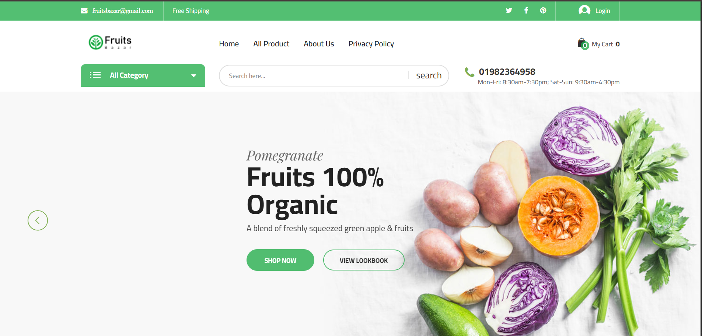
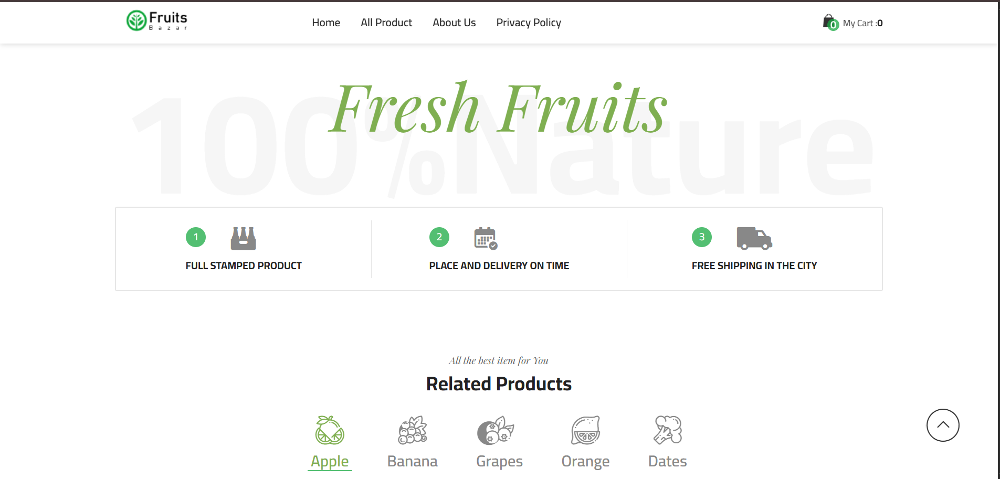
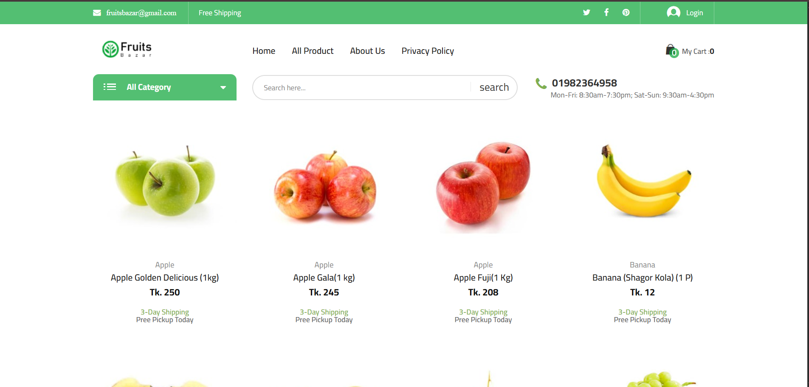
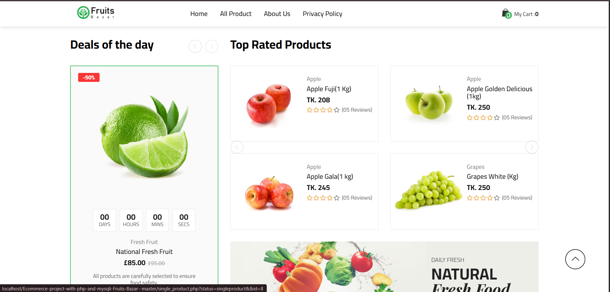

🍎 Fruits Bazar – Online Fruit Shopping Website

Fruits Bazar is a PHP and MySQL-based e-commerce website designed to make online fruit shopping simple and convenient. Customers can browse fruit products, explore categories, and use the website's shopping and account features.

📌 Project Overview

Project Name: Fruits Bazar

Project Type: E-commerce Web Application

Backend: PHP

Database: MySQL

Frontend: HTML, CSS, JavaScript, jQuery

Local Server: Apache using XAMPP

✨ Features

Browse fruit products and product categories.

View individual product details.

Search for products.

Customer registration and login.

Shopping cart functionality.

Customer profile and order-related pages.

Admin-side PHP functionality.

MySQL database integration.

Note: Available functionality depends on the modules configured in the project.

🛠️ Technologies Used

Technology

Purpose

HTML5

Webpage structure

CSS3

Website styling

JavaScript

Interactive functionality

jQuery

Frontend scripting

PHP

Server-side development

MySQL

Database management

XAMPP

Local development server

Git and GitHub

Version control and source-code hosting
## 📸 Screenshots

Here are screenshots of the Fruits Bazar E-Commerce website running locally.

### 🏠 Homepage — Hero Section

### 🎯 Homepage — Banner

### 🛍️ Product Listings

### 💰 Homepage — Deals

⚙️ Installation and Setup
Prerequisites
Install XAMPP and Git on your computer.
Step 1: Clone the Repository
Open Command Prompt and run:
git clone https://github.com/devidasshinde-01/Fruits-Bazar-Ecommerce.git
Step 2: Move the Project
Copy or move the downloaded project folder into:
C:\xampp\htdocs\
Step 3: Start XAMPP
Open the XAMPP Control Panel and start:
- Apache
- MySQL
Step 4: Create the Database
1. Open phpMyAdmin.
2. Create a database named ecommerce.
3. Select the database.
4. Open the Import tab.
5. Choose the project's ecommerce.sql file.
6. Click Import or Go.
Step 5: Configure Database Connection
Check the database connection settings in the PHP files, particularly:
admin/class/adminback.php
Configure the hostname, username, password, and database name according to your local MySQL setup.
Step 6: Run the Website
Open this URL in your browser:
http://localhost/Fruits-Bazar-Ecommerce/
If your project folder has a different name, use that folder name in the URL.
📁 Project Structure
Fruits-Bazar-Ecommerce/
├── admin/
├── assets/
├── includes/
├── json/
├── index.php
├── all_product.php
├── catagory.php
├── single_product.php
├── addtocart.php
├── user_login.php
├── user_register.php
├── userprofile.php
├── ecommerce.sql
└── README.md
🔒 Security Notes
- Do not publish real customer data or sensitive information.
- Never commit production passwords, API keys, or private credentials.
- Use secure password handling and input validation before deploying the website publicly.
- Configure appropriate database permissions for production.
👨‍💻 Developer
Devidas Shinde
GitHub: @devidasshinde-01
📄 License
Check the original project's license and obtain any required permission before redistributing or modifying it publicly.
